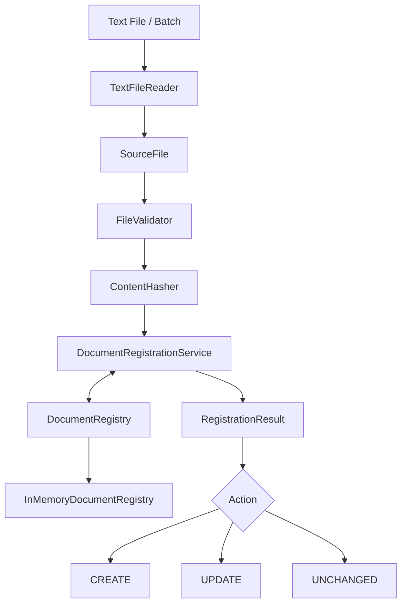
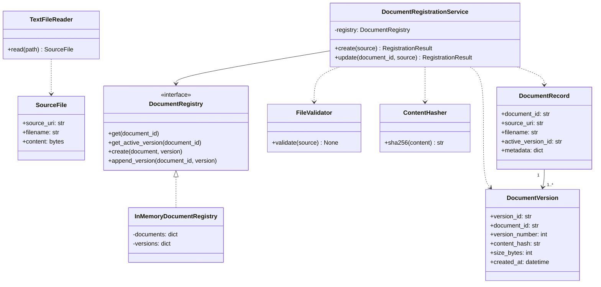
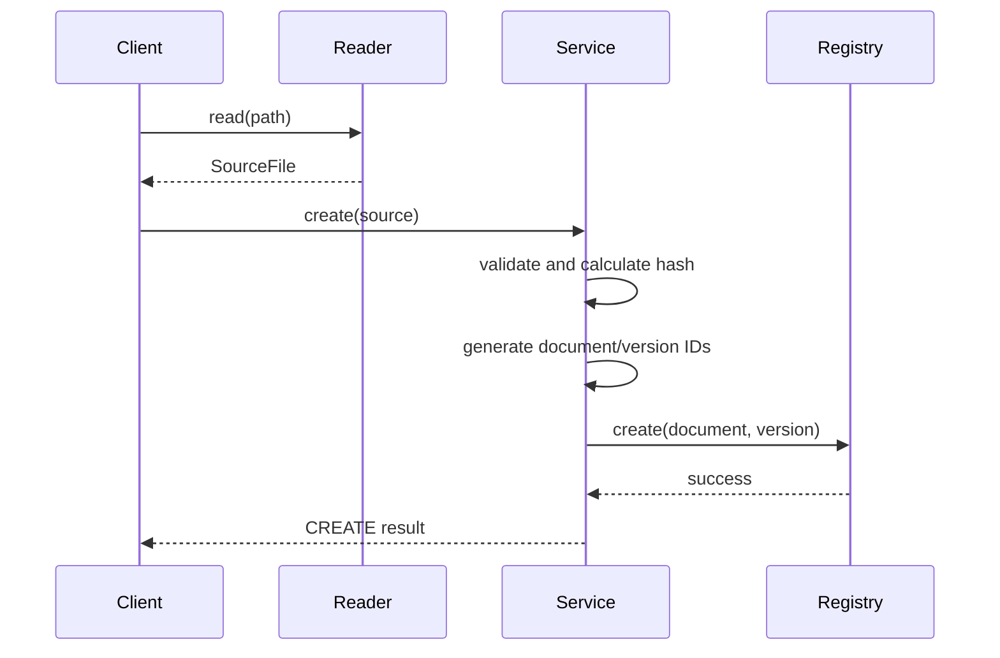
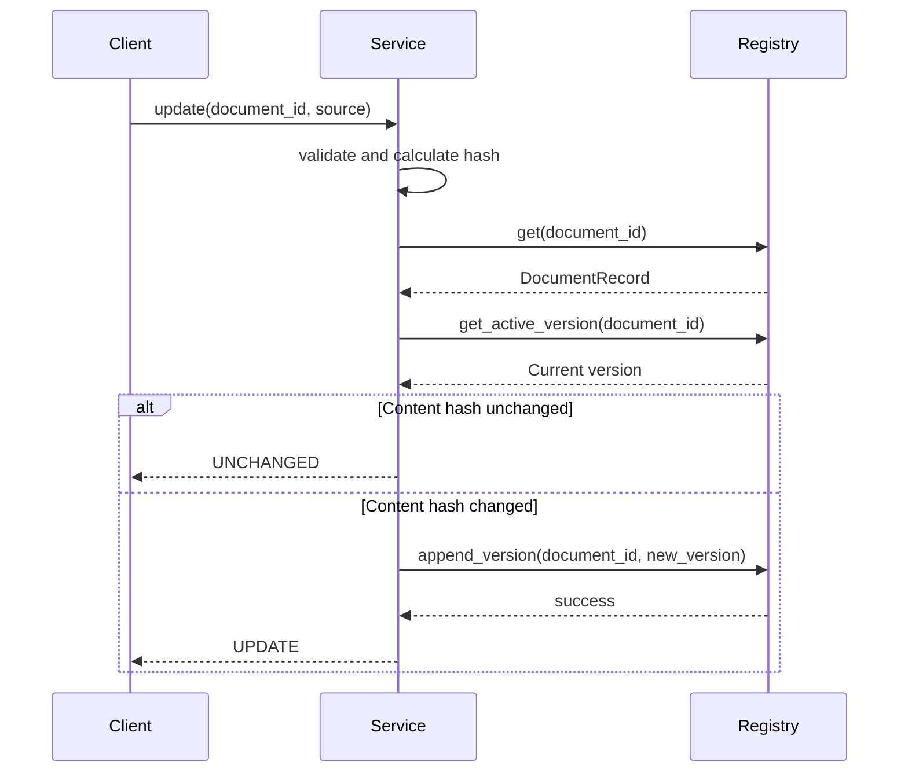

# KnowledgeForge — Design Specification 01
## Document Registration, Identity, Versioning and Duplicate Detection

**Status:** Approved for initial implementation  
**Phase:** 1 — Text File Ingestion Foundations  
**Implementation:** Python 3.12, Jupyter Notebook, OOP  
**Notebook:** `01_document_registration.ipynb`

---

## 1. Objective

Design and implement an extensible document registration system that accepts local text files, maintains logical document identities, detects content changes, manages document versions and supports sequential bulk registration.

The design must be independent of downstream RAG components such as chunking, embedding, vector storage and LLM generation.

The implementation will begin inside a Jupyter notebook and later be extracted into reusable Python modules.

### Learning objectives

- Understand logical document identity versus content identity.
- Apply object-oriented design and separation of concerns.
- Design canonical data models.
- Implement SHA-256 content hashing.
- Handle duplicate documents without accidentally merging identities.
- Implement document versioning.
- Define storage abstractions.
- Validate failure cases and edge conditions.
- Prepare for extensible ingestion of PDF, Markdown, logs and additional formats.

## 2. Scope

### 2.1 In scope

1. Local `.txt` file reading.
2. Source validation.
3. Source metadata extraction.
4. SHA-256 content hashing.
5. Logical document ID generation.
6. Document version creation.
7. Explicit document create and update operations.
8. Detection of unchanged document content.
9. In-memory document registry.
10. Sequential bulk registration.
11. Structured registration outcomes.
12. Unit-style validation using notebook assertions.

### 2.2 Out of scope

- Document parsing beyond basic text validation.
- LangChain text splitting.
- Embedding generation.
- Vector database indexing.
- Retrieval and reranking.
- Ollama and LLM generation.
- Distributed task queues.
- Concurrent uploads and distributed locking.
- Persistent database integration.
- Authentication and authorization enforcement.
- Document deletion and garbage collection.

These capabilities will be introduced in subsequent stages.

---

## 3. Terminology

| Term | Definition |
|---|---|
| Source | Physical file or external object from which content is read |
| Logical document | Independently identifiable document within the ingestion system |
| Document ID | Stable identifier for a logical document |
| Content hash | SHA-256 digest of the raw source bytes |
| Document version | Immutable representation of a specific content revision |
| Version ID | Unique identifier for a document version |
| Duplicate request | Repeated invocation of the same operation, potentially caused by retries |
| Content duplicate | Two sources containing identical bytes |
| Logical duplicate | Multiple registrations referring to the same intended logical document |
| Reindexing | Regenerating or updating derived search/index artifacts |

**Core invariant:** Two documents can have identical content hashes while retaining separate logical identities.

---

## 4. Functional Requirements

| ID | Requirement | Priority |
|---|---|---|
| FR-01 | Read local text files as bytes | P0 |
| FR-02 | Validate supported file format and size | P0 |
| FR-03 | Compute SHA-256 content hash | P0 |
| FR-04 | Assign unique document IDs | P0 |
| FR-05 | Create initial document version | P0 |
| FR-06 | Retrieve existing documents by document ID | P0 |
| FR-07 | Detect unchanged content during updates | P0 |
| FR-08 | Create new versions for modified content | P0 |
| FR-09 | Support identical filenames for different documents | P0 |
| FR-10 | Support identical content across multiple documents | P0 |
| FR-11 | Return structured registration results | P0 |
| FR-12 | Support sequential bulk document registration | P1 |
| FR-13 | Preserve source and version metadata | P1 |
| FR-14 | Provide meaningful validation and operation errors | P1 |

## 5. Non-Functional Requirements

### Extensibility

Adding PDF, Markdown or log readers must not require changing document identity or versioning rules.

### Determinism

The same input bytes must always produce the same SHA-256 hash.

### Testability

Registration logic must be independently testable without LangChain, Ollama or a vector database.

### Consistency

Document creation and initial version creation must behave as one logical operation. Failed operations must not leave partially registered records.

### Separation of concerns

Source reading, validation, hashing, identity management and persistence must have distinct responsibilities.

### Memory limits

The initial implementation may hold small text files in memory. File-size limits must be enforced. Future implementations should support streaming and durable source storage.

---

## 6. Architectural Design

### 6.1 High-level component flow



### 6.2 Responsibilities

**TextFileReader**

- Accept a local file path.
- Read raw bytes.
- Extract filename and source URI.
- Return a `SourceFile` object.

**FileValidator**

- Verify file existence and readability.
- Enforce `.txt` support and maximum file size.
- Validate text encoding when text decoding is required.
- Reject invalid inputs with meaningful exceptions.

**ContentHasher**

- Calculate SHA-256 from raw bytes.
- Remain independent of filename and metadata.

**DocumentRegistrationService**

- Coordinate registration.
- Create new logical document identities.
- Resolve explicit updates.
- Compare content hashes.
- Create document versions when necessary.
- Return structured outcomes.

**DocumentRegistry**

- Define the persistence contract for documents and versions.
- Avoid exposing storage implementation details.

**InMemoryDocumentRegistry**

- Implement registry behavior using Python dictionaries.
- Preserve relationships between documents and versions.

---

## 7. Canonical Data Models

### 7.1 SourceFile

Represents the raw input returned by a source reader.

```python
@dataclass(frozen=True)
class SourceFile:
    source_uri: str
    filename: str
    content: bytes
```

**Invariants**

- `source_uri` identifies where the file was read.
- `filename` is descriptive metadata, not document identity.
- `content` contains the unmodified raw bytes.
- File size is derived from `len(content)`.

### 7.2 DocumentRecord

Represents a logical document.

```python
@dataclass(frozen=True)
class DocumentRecord:
    document_id: str
    source_uri: str
    filename: str
    active_version_id: str
    metadata: dict[str, Any]
```

**Invariants**

- `document_id` is globally unique within this implementation.
- `document_id` remains stable across content updates.
- `active_version_id` identifies the current registered content version.
- Filename and source URI are not used as automatic uniqueness constraints.
- Metadata can change without changing document identity.

For Notebook 01, every successfully registered document has an initial active version. Therefore, `active_version_id` is required rather than optional.

### 7.3 DocumentVersion

Represents an immutable content revision.

```python
@dataclass(frozen=True)
class DocumentVersion:
    version_id: str
    document_id: str
    version_number: int
    content_hash: str
    size_bytes: int
    created_at: datetime
```

**Invariants**

- Every version belongs to exactly one logical document.
- Version numbers increase within a document.
- Versions are immutable after creation.
- Different documents may have identical content hashes.
- Version creation is triggered by changed content during an explicit update.

### 7.4 RegistrationResult

Represents the outcome of a registration operation.

```python
class RegistrationAction(str, Enum):
    CREATE = "create"
    UPDATE = "update"
    UNCHANGED = "unchanged"


@dataclass(frozen=True)
class RegistrationResult:
    action: RegistrationAction
    document_id: str
    version_id: str
    reason: str
```

This model provides a consistent contract for downstream processing.

---

## 8. Document Identity Policy

### 8.1 New documents

Calling:

```python
service.create(source)
```

creates a new logical document with a new document ID and version 1.

An identical filename or content hash in the registry does not automatically prevent creation.

### 8.2 Existing documents

Calling:

```python
service.update(document_id, source)
```

targets a specific existing logical document.

- If the content hash matches the current version, return `UNCHANGED`.
- If the content hash differs, create the next content version and return `UPDATE`.
- If the document ID does not exist, raise `DocumentNotFoundError`.

### 8.3 Source identity

The local file path is recorded for provenance but does not automatically determine document identity.

A future source synchronization API may use a stable connector-provided identity, for example:

`(tenant_id, connector_id, external_object_id)`

This policy is separate from explicit create and update operations.

---

## 9. Duplicate Handling

### 9.1 Decision matrix

| Scenario | Existing document ID? | Content comparison | Action |
|---|---|---|---|
| New document | No | Any hash | CREATE |
| Explicit update, same content | Yes | Same hash | UNCHANGED |
| Explicit update, changed content | Yes | Different hash | UPDATE |
| Same filename, independent upload | No | Different hash | CREATE |
| Different filename, identical content | No | Same hash elsewhere | CREATE |
| Same filename and content, independent new upload | No | Same hash elsewhere | CREATE |
| Unknown document ID used for update | Invalid ID | Not applicable | ERROR |

### 9.2 Important distinction

**Logical deduplication** and **processing deduplication** are separate concerns.

Notebook 01 will not attempt cross-document processing reuse.

Later, equivalent content under compatible processing configurations may reuse cached parsing, chunking or embedding artifacts while maintaining independent document IDs and authorization metadata.

### 9.3 Idempotency

Repeated independent `create()` calls may create multiple documents, even with identical content.

Production APIs will introduce idempotency keys to distinguish genuine new uploads from retried requests.

Idempotency keys must be scoped appropriately, associated with a request fingerprint and stored durably. Reusing a key for a different request must not silently return an unrelated result.

---

## 10. Versioning Policy

### CREATE

- Generate a new `document_id`.
- Generate a new `version_id`.
- Assign `version_number = 1`.
- Store the content hash and source metadata.
- Set `active_version_id` to the initial version.

### UPDATE

- Retrieve the current document and active version.
- Compute the incoming content hash.
- If unchanged, return the existing version.
- If changed, create a new immutable version.
- Increment `version_number`.
- Set `active_version_id` to the new version.

### UNCHANGED

- Retain the current content version.
- Do not create another version.
- Return the existing version ID.

For this first notebook, the active version means the latest registered content version, not a successfully published RAG index version.

Later, **registered version** and **searchable/published version** must be distinguished.

---

## 11. OOP Design

### 11.1 UML class diagram



### 11.2 Design principles

**Single Responsibility Principle**

Each class should handle a clearly defined responsibility.

**Dependency Inversion Principle**

The registration service depends on the registry contract rather than its in-memory implementation.

**Composition over inheritance**

Components collaborate through composition. Unnecessary class inheritance should be avoided.

**Interface Segregation**

Keep registry operations focused on document and version persistence.

**Extensibility**

Source-specific processing should not leak into the document registration domain.

---

## 12. Registry Contract

The initial registry requires four operations:

```python
get(document_id) -> DocumentRecord | None

get_active_version(document_id) -> DocumentVersion

create(document, version) -> None

append_version(document_id, version) -> None
```

`append_version()` must also atomically update the document's active version reference.

The in-memory implementation should enforce:

- Unique document IDs.
- Unique version IDs.
- Unique `(document_id, version_number)` pairs.
- Valid document-version relationships.
- Monotonically increasing version numbers.
- No mutation of previously registered versions.
- No partially committed create/update operations.

Concurrent modification support is deferred. A production implementation will require transactional storage and appropriate optimistic concurrency or locking.

---

## 13. Registration Sequence

### New document



### Existing document update



---

## 14. Validation and Error Handling

Define a small, meaningful exception hierarchy.

```text
DocumentRegistrationError
├── InvalidSourceError
├── UnsupportedFileTypeError
├── FileTooLargeError
├── DocumentNotFoundError
└── RegistryConflictError
```

Missing files and unreadable files may also propagate appropriate standard Python exceptions from the reader.

### Required edge cases

- Nonexistent file.
- File is not readable.
- Unsupported extension.
- File exceeds configured size limit.
- Empty text file.
- Invalid UTF-8 content.
- Unknown document ID.
- Same filename across different paths.
- Identical content across different documents.
- Unchanged content during explicit update.
- Failed version creation.

**Initial policy:** Accept valid zero-byte `.txt` files for registration, with an empty SHA-256 hash. Later parsing or indexing may mark them as having no searchable content.

Use strict UTF-8 decoding for text validation rather than silently replacing invalid bytes.

---

## 15. Bulk Registration

### Initial implementation

Support:

```python
results = [
    service.create(reader.read(path))
    for path in file_paths
]
```

Each path is treated as an independent create request.

A batch with four new files produces four logical documents even when some filenames or content hashes are identical.

### Batch failure semantics

For Notebook 01:

- Process files sequentially.
- Failures for individual files should be reportable.
- Successfully completed registrations remain committed.
- Do not claim that the entire batch is transactional.

A future bulk ingestion service can introduce:

- Parallel processing.
- Atomic processing claims.
- Idempotency keys.
- Distributed work queues.
- Leases and crash recovery.
- Processing artifact reuse.
- Retry and dead-letter handling.

---

## 16. Acceptance Criteria

The task is complete when all of the following cases pass.

| Test | Expected result |
|---|---|
| Create a new TXT document | New ID, version 1 |
| Create another document with same filename | Different document ID |
| Create another document with identical content | Different document ID |
| Update existing document with unchanged bytes | UNCHANGED, same version |
| Update existing document with modified bytes | UPDATE, next version |
| Update unknown document ID | Error |
| Register empty TXT file | Valid registration under initial policy |
| Register invalid UTF-8 file | Validation error |
| Register unsupported file | Validation error |
| Register missing file | File read error |
| Register sequential bulk upload | One result per file |
| Simulate failed registry operation | No partially committed document/version |
| Retrieve document version history | Correct ordered versions |
| Rehash identical input bytes | Identical digest |

### Final expected result

The notebook should demonstrate:

```text
CREATE → doc-001 → V1 → abc123
UPDATE → doc-001 → V2 → xyz789
UNCHANGED → doc-001 → V2 → xyz789

CREATE → doc-002 → V1 → abc123
```

Here `doc-001` and `doc-002` are different logical documents, even though one of their content versions has the same content hash.

---

## 17. Notebook Implementation Order

### Step 1 — Canonical models

Implement `SourceFile`, `DocumentRecord`, `DocumentVersion` and `RegistrationResult`.

Understand the invariants and why dataclasses are appropriate.

### Step 2 — Source reader and validation

Read a `.txt` file as bytes. Validate file extension, size and encoding.

### Step 3 — Content hashing

Implement SHA-256 and verify deterministic behavior.

### Step 4 — Registry interface

Define the storage contract and implement an in-memory registry.

### Step 5 — Registration service

Implement explicit document creation, update and unchanged-content detection.

### Step 6 — Duplicate scenarios

Exercise filename collisions, identical content, document versions and invalid identity references.

### Step 7 — Sequential bulk registration

Register multiple text files and verify independent logical document identities.

### Step 8 — Review and refactor

Review class responsibilities, correctness, testability, unnecessary abstractions and extension points.

---

## 18. Future Architecture Roadmap

| Phase | Capability |
|---|---|
| 01 | Document registration, identity, duplicate detection and versioning |
| 02 | Text parsing and canonical parsed documents |
| 03 | LangChain chunking strategies |
| 04 | Local embedding generation |
| 05 | Chroma vector indexing and indexed-version management |
| 06 | Retrieval and similarity search |
| 07 | RAG generation using LangChain and Ollama `qwen:8b` |
| 08 | PDF, Markdown and log ingestion |
| 09 | Bulk ingestion, persistent storage, retries and concurrency |
| 10 | RAG evaluation, hybrid retrieval, reranking and observability |

Future versions should introduce a separate indexing lifecycle with states such as `PENDING`, `PROCESSING`, `COMPLETED` and `FAILED`, alongside an independently tracked published index generation.

---

## 19. Design Decisions and Trade-offs

| Decision | Rationale | Trade-off |
|---|---|---|
| Explicit document ID | Prevent accidental identity merging | Caller must track IDs for updates |
| SHA-256 of bytes | Reliable change detection | Semantically identical files may have different hashes |
| Immutable versions | Preserves history and traceability | Additional metadata/storage required |
| In-memory registry | Easy to learn and test | No restart persistence or cross-process consistency |
| Separate registration from indexing | Clear domain boundaries | Additional orchestration later |
| Simple OOP composition | Easier to understand and extend | Some responsibilities may later require dedicated abstractions |
| Sequential bulk processing | Deterministic first implementation | Limited throughput |
| Independent logical documents | Preserves provenance and future ACL boundaries | Identical content may initially be processed multiple times |

---

## 20. Definition of Done

Notebook 01 is complete when:

- All canonical models and their invariants are understood.
- Reader, validator, hasher, registry and registration service work together.
- Explicit create and update operations behave correctly.
- Duplicate scenarios produce the intended results.
- Version history remains consistent.
- All acceptance tests pass.
- The core classes can be extracted into Python modules without changing their public behavior.
- No dependency on LangChain, Ollama or a vector database is required.

**Final architectural principle:**

Document identity determines *which document* is being managed.

Content hashing determines *whether its bytes have changed*.

Document versioning records *the history of those changes*.

The future ingestion and indexing lifecycle determines *how content becomes searchable*.

These concerns must remain separate as KnowledgeForge evolves into a production-grade RAG platform.
